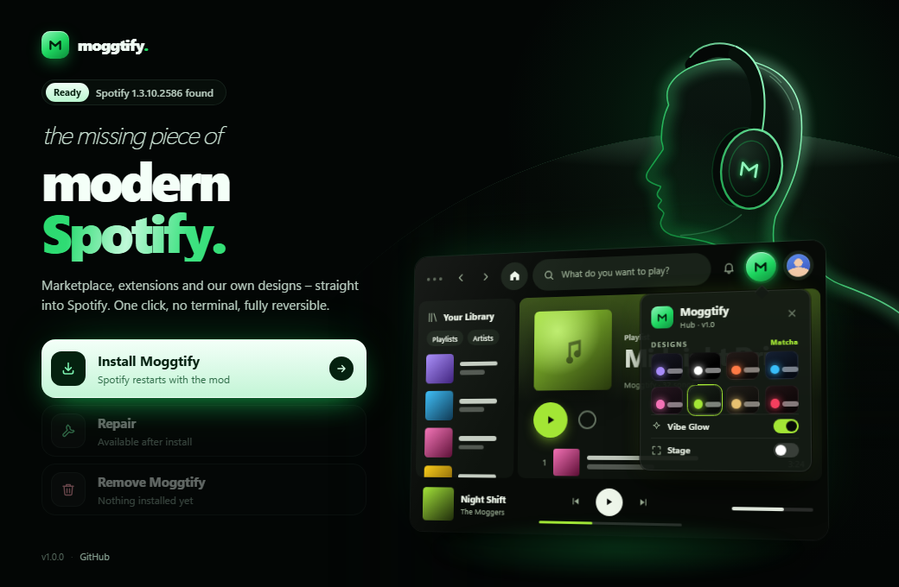
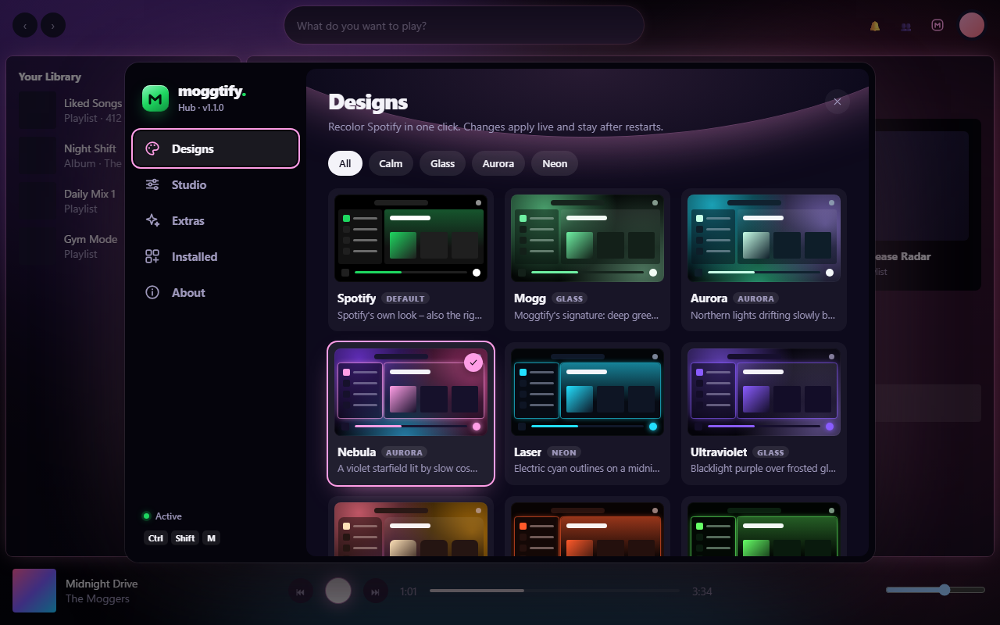
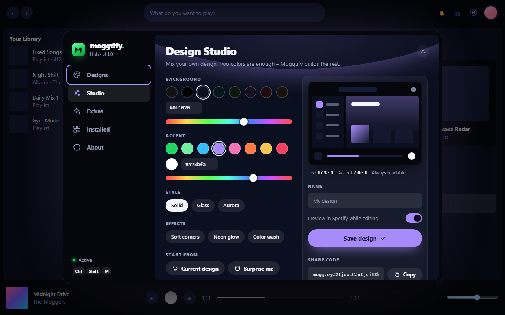
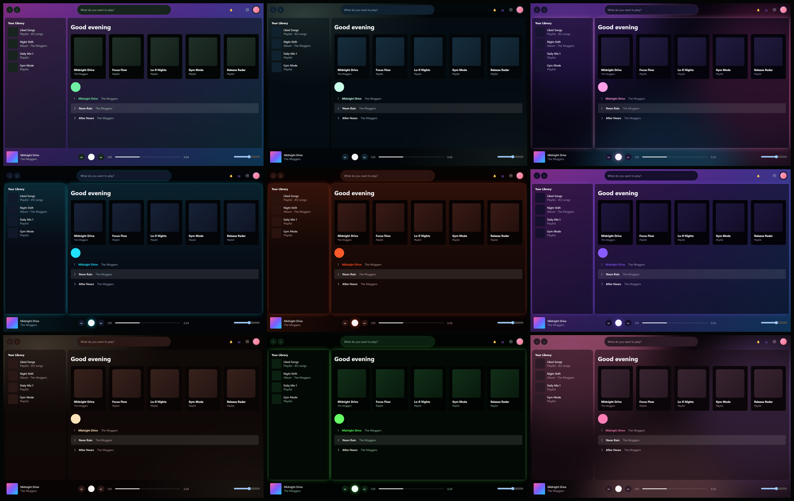
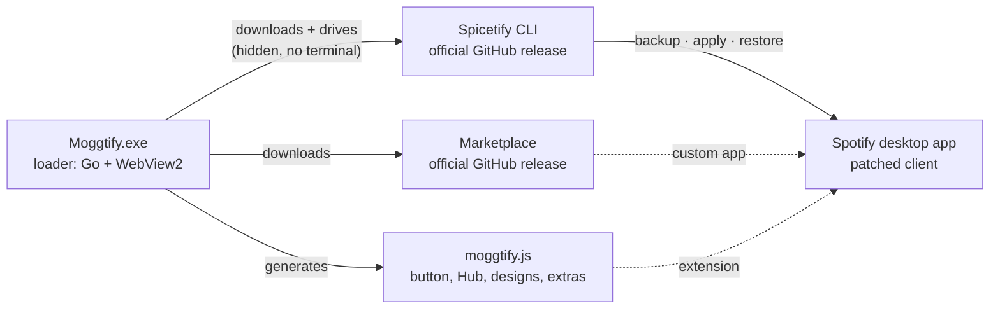

<div align="center">


# Moggtify

**Spotify, unlocked.**

One click adds the Marketplace, a hand-picked set of extensions and Moggtify's own designs to the Spotify desktop app. No terminal, nothing to configure.

[**Download Moggtify.exe**](https://github.com/caedesdev/moggtify/releases/latest/download/Moggtify.exe) &nbsp;·&nbsp; [Releases](https://github.com/caedesdev/moggtify/releases) &nbsp;·&nbsp; [FAQ](#faq) &nbsp;·&nbsp; [Build from source](#build-from-source)

[](https://github.com/caedesdev/moggtify/actions/workflows/ci.yml)
[](https://github.com/caedesdev/moggtify/releases/latest)
[](LICENSE)
[](#install)



</div>

## What you get

- **The Marketplace.** Browse and install community themes, extensions, snippets and apps without leaving Spotify.
- **A curated starter set** of classic extensions and apps, switched on and ready to use (table below).
- **The [Moggtify Hub](#moggtify-inside-spotify)** inside Spotify, with Moggtify's own designs and extras. Spotify keeps its normal look until you pick a design.
- **Survives Spotify updates.** When an update removes the mod, Moggtify puts it back.
- **Fully reversible.** One click restores the original Spotify.

| Starter set | What it does | Where to find it |
|---|---|---|
| **Marketplace** | Community themes, extensions, snippets and apps, right inside Spotify. | Shop icon in Spotify's top bar |
| **Lyrics Plus** | Synced lyrics from Musixmatch, Netease and LRCLIB, with karaoke mode. | Lyrics Plus icon in the top bar |
| **New Releases** | Everything new from the artists and podcasts you follow, in one feed. | New Releases icon in the top bar |
| **Full App Display** | Full-screen now playing view with huge album art and a blurred background. | Profile menu → Full App Display, or double-click the cover art |
| **Trash Bin** | Throw songs or artists in the bin and never hear them again. | Right-click a song or artist → Throw to Trashbin |
| **Shuffle+** | A real shuffle (Fisher–Yates) for playlists, albums and your library. | Right-click a playlist or album → Play with Shuffle+ |
| **Bookmark** | Save pages, tracks and exact timestamps to jump back to later. | Bookmark button in the top bar |
| **Loopy Loop** | Loop any section of a track straight from the progress bar. | Right-click the progress bar to set loop start and end |
| **Pop-up Lyrics** | Synced lyrics in a separate always-on-top window. | Lyrics button in the top bar |
| **Skip Videos** | Skips region-locked video content that won't play. | Works automatically |

Everything else is one click away in the Marketplace.

## Install

1. Download **[Moggtify.exe](https://github.com/caedesdev/moggtify/releases/latest/download/Moggtify.exe)** from the latest release.
2. Run it. Windows SmartScreen may show *"Windows protected your PC"* because the exe isn't code-signed: click **More info**, then **Run anyway**.
3. Click **Install**. Moggtify sets everything up, closes Spotify for a moment and starts it again with the mod.
4. In Spotify, click the new **M** button next to your profile picture.

**Requirements:** Windows 10 or 11 · the Spotify desktop app from [spotify.com](https://www.spotify.com/download/windows/) (not the Microsoft Store version), started at least once · the WebView2 Runtime (built into Windows 11; Moggtify offers the download if it's missing). No admin rights needed.

<details>
<summary><b>Verify your download</b></summary>

<br>

Every release also ships `Moggtify.exe.sha256`. With both files in the same folder:

```powershell
(Get-FileHash .\Moggtify.exe -Algorithm SHA256).Hash -eq (Get-Content .\Moggtify.exe.sha256).Split(" ")[0]
```

`True` means you have exactly the file the release workflow built.

</details>

## The loader: three actions

The Moggtify app (the *loader*) does three things, and only these three:

| | What happens | Use it when |
|---|---|---|
| **Install** | Installs Moggtify for your Windows account (Start menu, desktop shortcut, *Installed apps* entry), downloads the latest engine and Marketplace, sets up the starter set and the Hub, patches Spotify and restarts it. | First time. |
| **Repair** | Refreshes the installed Moggtify, updates the engine and the Marketplace, re-syncs everything and patches Spotify again. | A Spotify update removed the mod, or something looks off. |
| **Remove Moggtify** | Asks first. Restores the original Spotify, removes the Spicetify engine if Moggtify installed it, then removes Moggtify itself: shortcuts, autostart, settings and program folder. | You want plain Spotify back. |

Every action shows its steps live. If one fails, you get the engine's actual error message with a **Copy** button, ready for a bug report.

## Moggtify inside Spotify

After Install, Spotify restarts with Moggtify. In the top bar, right next to your profile picture, there's a new **M** button. Click it, or press <kbd>Ctrl</kbd>+<kbd>Shift</kbd>+<kbd>M</kbd> anywhere in Spotify, to open the **Moggtify Hub**:

- **Designs.** 26 of Moggtify's own designs for the whole client, applied instantly and filterable by style: calm palettes, **Glass** (blurred cover art behind translucent panels), **Aurora** (slow drifting lights) and **Neon** (glowing outlines). The Spotify design keeps the original look: it's the default, and the one to pick when you use a theme from the Marketplace.
- **Design Studio.** Make your own: pick a background and an accent, choose a style and effects, and Moggtify builds a complete, always-readable palette around them, live in Spotify while you edit. Save up to 24 designs and share any of them as a short `mogg:` code.
- **Extras.** Small add-ons you switch on and off live: Stage (cinematic full-screen now playing, <kbd>F8</kbd>), Vibe Glow (the accent color follows the cover), Ambient (soft album-art glow behind the app), Smart Skip (skips live, sped-up, slowed or remix versions), Wheel Volume (scroll over the player bar) and Clean UI (hides upgrade buttons and banners).
- **What's installed.** Every extension and app Moggtify set up, and where to find it.

<p align="center">
  
</p>
<p align="center">
  
</p>
<p align="center">
  
</p>

## FAQ

<details>
<summary><b>I don't see the M button in Spotify.</b></summary>

<br>

It appears a moment after Spotify has loaded, right next to your profile picture. <kbd>Ctrl</kbd>+<kbd>Shift</kbd>+<kbd>M</kbd> opens the Hub as well. Still nothing? Open Moggtify and click **Repair**.

</details>

<details>
<summary><b>Spotify updated and the mod is gone.</b></summary>

<br>

Moggtify's update helper starts with Windows, notices when a Spotify update replaces the patched client and re-applies everything on its own. If Spotify is open at that moment, it restarts once. If that didn't work, open Moggtify and click **Repair**.

</details>

<details>
<summary><b>Does it work with Spotify from the Microsoft Store?</b></summary>

<br>

No. The Store version lives in a sealed system folder that can't be patched. Uninstall it, install Spotify from [spotify.com/download](https://www.spotify.com/download/windows/), sign in once, then run Moggtify again.

</details>

<details>
<summary><b>How do I uninstall it?</b></summary>

<br>

Open Moggtify and click **Remove Moggtify**, or go to **Settings › Apps › Installed apps › Moggtify › Uninstall** in Windows, which opens the same flow. Either way, Spotify is restored to its original state.

</details>

<details>
<summary><b>Is it safe? Can I undo it?</b></summary>

<br>

- Moggtify needs no admin rights and only touches your own user profile.
- Spotify is patched by [Spicetify](https://spicetify.app), the established open-source mod engine, downloaded straight from its official GitHub releases. Moggtify ships no modified Spotify files.
- Spicetify keeps a backup of the original client, and **Remove Moggtify** restores it.
- The exe isn't code-signed, hence the SmartScreen prompt. Every release lists a SHA-256 checksum, and you can always [build it yourself](#build-from-source).

</details>

<details>
<summary><b>Does it block ads?</b></summary>

<br>

No. Moggtify doesn't block or skip ads and doesn't unlock Premium features. It changes how the client looks and adds features on top; your Spotify plan works exactly as before. (The optional Clean UI extra only hides upgrade buttons and promo banners in the interface.)

</details>

<details>
<summary><b>I already use Spicetify. Does Moggtify work with it?</b></summary>

<br>

Yes. Moggtify uses your existing engine (and updates it to the latest release), keeps your current theme and leaves extensions it doesn't manage alone. Because Moggtify didn't install the engine, Remove Moggtify leaves it in place. It does restore Spotify itself to the original, so run `spicetify apply` afterwards to bring your own setup back.

</details>

## How it works



1. **The loader** (`Moggtify.exe`, Go + WebView2, one file of about 8 MB) copies itself to `%LOCALAPPDATA%\Programs\Moggtify` and registers with Windows: Start menu, desktop shortcut, *Installed apps* entry and an autostart entry for the update helper. Everything is per-user.
2. **The engine** is [Spicetify CLI](https://github.com/spicetify/cli). Moggtify downloads the latest release from GitHub, or updates the one you already have, and runs it in hidden processes, so you never see a terminal.
3. **The Marketplace** comes from its official GitHub release and is registered as a Spicetify custom app, together with the starter set.
4. **moggtify.js** is a single Spicetify extension the loader generates: Moggtify's runtime, designs and extras in one file. Designs are ordinary Spicetify color schemes; they set the same `--spice-*` variables every Spicetify theme uses.
5. **The update helper** (`Moggtify.exe --background`) starts with Windows, checks every 30 seconds whether a Spotify update replaced the patched client, and re-applies everything when it did.

<details>
<summary><b>Where things live</b></summary>

<br>

| What | Where |
|---|---|
| Moggtify | `%LOCALAPPDATA%\Programs\Moggtify` |
| Moggtify settings and WebView2 cache | `%LOCALAPPDATA%\Moggtify` |
| Spicetify engine | `%LOCALAPPDATA%\spicetify` |
| Spicetify data (config, Marketplace, extensions) | `%APPDATA%\spicetify` |
| Spotify, patched in place | `%APPDATA%\Spotify` |
| Uninstall entry | `HKCU\Software\Microsoft\Windows\CurrentVersion\Uninstall\Moggtify` |
| Autostart (update helper) | `HKCU\Software\Microsoft\Windows\CurrentVersion\Run`, value `Moggtify` |

</details>

<details>
<summary><b>Command line</b></summary>

<br>

| Command | What it does |
|---|---|
| `Moggtify.exe` | Opens the loader. |
| `Moggtify.exe --uninstall` | Opens the loader in Remove mode (used by Windows Settings). |
| `Moggtify.exe --uninstall --quiet` | Uninstalls without a window. |
| `Moggtify.exe --background` | Runs the update helper (started at login). |
| `Moggtify.exe --dump-extension <file>` | Writes the in-Spotify bundle to a file (development). |

</details>

## Build from source

You need Windows 10 or 11, [Go](https://go.dev/dl/) (version in [`go.mod`](go.mod)) and PowerShell 5.1 or later. Node.js and Microsoft Edge are only needed for the UI previews.

```powershell
git clone https://github.com/caedesdev/moggtify
cd moggtify
.\build.ps1          # → dist\Moggtify.exe
```

`build.ps1` draws the icons if they're missing (`tools/make-icon.ps1`), installs [go-winres](https://github.com/tc-hib/go-winres) if needed to embed icon, manifest and version info, then builds a static GUI binary without a console (`CGO_ENABLED=0`, `-trimpath -ldflags "-s -w -H windowsgui"`).

> [!CAUTION]
> A loader you build is the real thing: Install, Repair and Remove act on your actual Spotify. Back it up first, or try it in Windows Sandbox or a VM.

**Tests**

```powershell
go vet ./...
go test ./...
```

Unit tests run against a throwaway `%APPDATA%` and `%LOCALAPPDATA%` and never start or stop Spotify. With Node.js on `PATH` they also syntax-check the generated `moggtify.js`.

**Sandbox integration test.** Runs the real Spicetify engine (config, backup and apply, re-apply, restore) against a *copy* of Spotify. Use a separate terminal, because the unit tests read these variables too:

```powershell
$env:MOGG_SANDBOX     = "1"
$env:MOGG_SPOTIFY_DIR = "D:\mogg-sandbox\Spotify"    # copy of an un-modded %APPDATA%\Spotify
$env:SPICETIFY_CONFIG = "D:\mogg-sandbox\spicetify"  # holds config-xpui.ini
$env:SPICETIFY_STATE  = "D:\mogg-sandbox\state"      # Spicetify's backups
go test -run SandboxPatch -v
```

> [!WARNING]
> `config-xpui.ini` must exist in that folder **before** the first run, with `spotify_path` and `prefs_path` pointing at the copy. Otherwise Spicetify generates one for your real Spotify. Full setup, plus the Spotify-update test: [CONTRIBUTING.md](CONTRIBUTING.md#sandbox-integration-tests).

**UI previews.** Work on the loader in a normal browser, with the Go bridge mocked:

```powershell
node tools/preview/build.mjs ui/index.html dist/preview/index.html
powershell -NoProfile -File tools/preview/screenshot.ps1 -Html ui/index.html -Out dist/shots
```

The first command writes a preview to open in any browser; add a query such as `?state=installed`, `?state=outdated` or `?state=fresh&click=install&hold=patch`. The second renders eight states (fresh, installed, outdated, nospotify, running, success, error, uninstall) to PNGs with headless Edge.

**More helpers**

- `go run . --dump-extension dist/moggtify.js` writes the in-Spotify bundle exactly as Install would.
- Set `MOGG_DEBUG=1` before starting the loader to enable the WebView2 DevTools.

## Project layout

```text
main.go             entry point: window, single-instance lock, command-line flags
app.go              loader ↔ Go bridge: mogg_* functions, progress/done/error events
engine.go           downloads and drives Spicetify, installs the Marketplace, patch/restore
catalog.go          the curated extensions and apps, builds the moggtify.js bundle
spotify.go          finds Spotify, reads its patch status, closes and starts it
setup.go            self-install, shortcuts, Installed apps entry, autostart, uninstall
watcher.go          the update helper that re-applies after Spotify updates
paths.go            version, folders, config.json, file helpers
winapi.go           Win32 helpers: DPI, dark title bar, message box, shell open
*_test.go           unit tests and the opt-in sandbox integration test
ui/index.html       the loader UI: one self-contained HTML file, embedded into the exe
runtime/            runs inside Spotify: moggtify.js (button + Hub), themes.json (designs),
                    extensions.json + extensions/*.js (extras)
tools/              make-icon.ps1, check-designs.mjs (design + contrast check),
                    preview/ (mock bridge, preview build, headless screenshots)
winres/             icon PNGs and winres.json (manifest, version info) for go-winres
docs/screenshots/   images used in this README
build.ps1           release build → dist\Moggtify.exe
```

## Contributing

Issues and pull requests are welcome. [CONTRIBUTING.md](CONTRIBUTING.md) covers setup, previews, tests and code style. For bugs, the [issue form](https://github.com/caedesdev/moggtify/issues/new/choose) asks for exactly what helps.

## Credits

- [Spicetify CLI](https://github.com/spicetify/cli) (LGPL-2.1), the engine that patches Spotify. The starter-set extensions and apps (Full App Display, Lyrics Plus and friends) ship with it.
- [Spicetify Marketplace](https://github.com/spicetify/marketplace), the store inside Spotify.
- Both are downloaded from their official GitHub releases at install time; Moggtify doesn't redistribute them.
- Built with [go-webview2](https://github.com/jchv/go-webview2) and [go-winres](https://github.com/tc-hib/go-winres).

## License

[MIT](LICENSE) © 2026 Moggtify contributors. Spicetify and the Marketplace are covered by their own licenses.

## Disclaimer

Moggtify is an independent community project. It is not affiliated with, endorsed by or connected to Spotify AB, and "Spotify" is a trademark of Spotify AB. Moggtify modifies the Spotify desktop client on your PC, which Spotify's terms may not allow: use it at your own risk and respect the [Spotify Terms of Use](https://www.spotify.com/legal/end-user-agreement/). Moggtify is not an ad blocker and does not unlock Premium features or download music.
